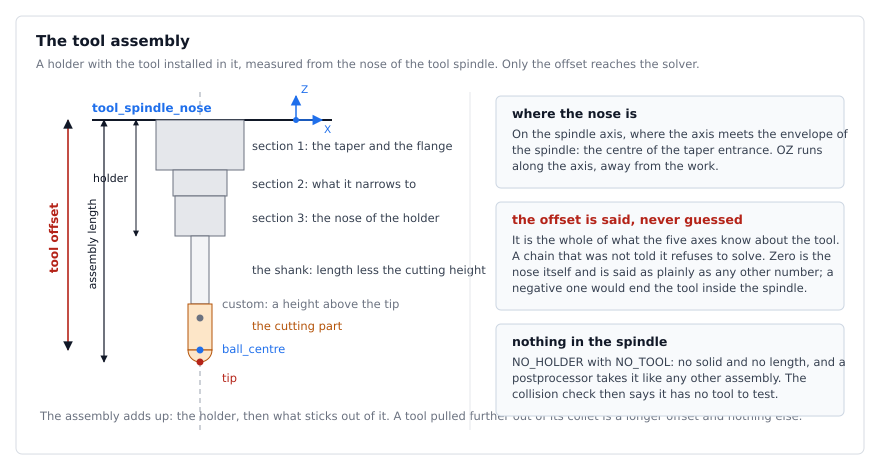
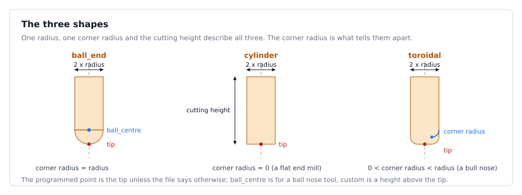
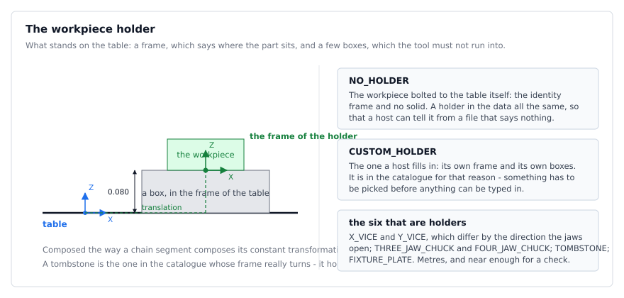

# What is in the spindle and what is on the table

A kinematic chain of this library has two ends, and each of them carries something the kinematics
does not: the **nose of the tool spindle** carries a holder and the tool in it, the **table** carries
whatever the workpiece is clamped in. Neither takes part in solving a cutter location. They are
there because a collision check needs solids, and because a host that opens a machine file should not
have to invent a holder before it can draw one.

The two terminals are named `tool_spindle_nose` and `table` in a `.kc.json` file of format version 2,
and `CHAIN_SEGMENT_TOOL_SPINDLE_NOSE` / `CHAIN_SEGMENT_TABLE` in the library. The XML form of the
format (`.kc`) was retired; `tools/kc2json` converts one, renaming the two terminals on the way.

## The tool assembly

The nose of the spindle is the point on the spindle axis where the axis meets the spindle envelope -
the centre of the taper entrance - with OZ along the axis, pointing away from the work. Everything
that hangs from it hangs down its negative OZ:



Three lengths are measured from that point, and only one of them matters to the kinematics:

| length | what it is | who uses it |
| --- | --- | --- |
| `CToolHolder::GetLength()` | the nose down to where the holder ends and the tool begins | drawing, collisions |
| `CToolAssembly::GetLength()` | the nose down to the tip of the tool | drawing, collisions, gouge checks |
| `CToolAssembly::GetToolOffset()` | the nose down to the point a cutter location programs | **the solver** |

The last one is the **tool offset**. It is the whole of what the five axes know about the tool, and
it is never guessed at: a chain that was not told it refuses to solve and says so
(`CChain::IsToolOffsetGiven`). It is a distance below the nose, so it is positive; a negative offset
would end the tool inside the spindle and is refused. Zero is a place - the nose itself - and has to
be said as plainly as any other number.

A `CToolAssembly` is a `CToolHolder` with a `CToolDescription` in it, and it answers both lengths.
`CChain::GetDefaultToolAssembly()` hands over the one the file describes, which goes into a
postprocessor call like any other.

### The holder

Up to three cylinders, given from the nose downwards, and the designation on the holder itself:
`"BT40 ER32"`, `"HSK63A SF12"`. The library never reads the name; a host matches it against the
holders it has of its own. Nobody machines from this model, so the taper is a cylinder, the flange is
a cylinder and the nose is a cylinder - enough to tell a slim collet chuck from a face-mill arbor for
the one question the library asks: does it meet a part of the machine, or plough through material
that was still there?

`NO_HOLDER` is the tool clamped straight into the spindle: a holder that is present in the data, with
no cylinder, no length and nothing to collide with.

```json
"tool_holder": {
  "model": "HSK63A ER32",
  "sections": [
    { "length": 0.050, "radius": 0.040 },
    { "length": 0.025, "radius": 0.027 },
    { "length": 0.040, "radius": 0.025 }
  ]
}
```

A holder of one cylinder may be written the short way, which is what the shipped machines use:

```json
"tool_holder": { "length": 0.05, "radius": 0.03 }
```

### The tool

The tool of a chain file is a plain value - dimensions and nothing that moves - because a chain is
copied and a `CMillingTool` is a polymorphic object with a position of its own.
`CToolDescription::MakeTool(holder)` builds the solids when a caller wants them.



| member | means |
| --- | --- |
| `type` | `ball_end`, `cylinder` or `toroidal` |
| `radius` | the radius of the tool: half the cutting diameter |
| `corner_radius` | the ball of a ball nose tool; the rounding of the bottom edge of a toroidal one |
| `cutting_height` | how far the cutting part reaches up from the tip |
| `length` | the whole length that sticks out of the holder - not the gauge length |
| `reference_point` | `tip`, `ball_centre` or `custom` |
| `reference_height` | for `custom`: above the tip, measured towards the spindle |

`length` is what sticks out, so the assembly adds up: the holder, then the tool. A tool pulled
further out of its collet is a longer `length` and a longer offset, and nothing else changes.

```json
"tool": {
  "type": "ball_end",
  "radius": 0.008,
  "corner_radius": 0.008,
  "cutting_height": 0.030,
  "length": 0.060,
  "reference_point": "ball_centre"
}
```

### Nothing in the spindle

An **empty assembly** is `NO_HOLDER` with `NO_TOOL`: no solid, no length, nothing to collide with.
`CToolAssembly::Empty()` is it, and a postprocessor takes it like any other assembly - the offset is
zero, the processing is the same, and the collision check says in its log that it has no tool to
test. A machine between jobs is the other half of the same idea: a holder with no tool in it, which
has a length and a body and no cutting part.

### What a postprocessor is given

Two calls, and a caller uses one of them; nothing is assumed about what is in the spindle.

```cpp
//the geometry: the offset is all the five axes depend on. Refused when the settings check collisions
Solve(r3pPosition, r3vOrientation, oChain, dToolOffset, sLog, oReport);
//the whole thing: its own offset for the geometry and its solids for the collisions
Solve(r3pPosition, r3vOrientation, oChain, oAssembly, sLog, oReport);
```

Across the C interface the same choice is a tool handle or one call:

```c
k5_chain_set_tool_offset(chain, 0.144);   /* the geometry, for a host with no solids */
k5_solve_location(chain, tool, &settings, p, v, NULL, 0, &count, &status);  /* or the whole tool */
```

A solve without a `k5_tool` is refused until something has said how far the tool reaches, and the
message names the call that says it.

## The workpiece holder

The table is the terminal of the workpiece branch. What stands on it - a vice, a chuck, a tombstone,
a plate - is a frame and a few solids: the frame says where the workpiece sits, the solids are what
the tool must not run into.



The frame is given the way a chain segment gives its constant transformation, as a translation and a
rotation about an axis, and composed the same way; the solids are boxes in the frame of the table.

```json
"workpiece_holder": {
  "model": "X_VICE",
  "translation": [0.0, 0.0, 0.080],
  "rotation": { "axis": [0.0, 0.0, 1.0], "angle_deg": 0.0 },
  "boxes": [
    { "min": [-0.150, -0.075, 0.0], "max": [0.150, 0.075, 0.080] }
  ]
}
```

Two designations are not holders at all and are in the catalogue for that reason:

* `NO_HOLDER` - the workpiece bolted to the table itself: the identity frame and no solid.
* `CUSTOM_HOLDER` - the one a host fills in, frame and boxes.

## The catalogues

Both are lists a host picks from rather than measures, and both are **in metres**, which is the unit
of every machine shipped with this library. A host whose chain is in another unit scales them; the
editor does.

| catalogue | entries | the first ones |
| --- | --- | --- |
| `ToolHolderFromCatalogue` | 11 | `NO_HOLDER`, then the usual tapers |
| `WorkpieceHolderFromCatalogue` | 8 | `NO_HOLDER`, `CUSTOM_HOLDER`, then X and Y vices, chucks, a tombstone, a plate |

The sizes are the usual ones for each taper and each fixture, and they are near enough for a
collision check. They are no substitute for measuring what is on the machine: a chuck is a box around
the cylinder, which is wider than the cylinder, and will refuse a pose or two it could have allowed.
